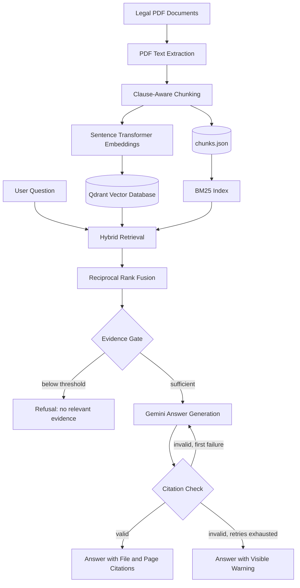

# Legal Evidence Intelligence Agent

An AI-powered legal document analysis agent that retrieves evidence from PDF documents and generates context-grounded answers with file- and page-level citations that are verified in code.

Built using **Python, LangGraph, Gemini, Qdrant, and Sentence Transformers**.

## Overview

Legal documents often contain large amounts of information spread across multiple pages and files. Finding relevant clauses, extracting facts, and verifying answers manually can be time-consuming.

The Legal Evidence Intelligence Agent aims to simplify this process by combining hybrid information retrieval with LLM-powered reasoning, and by checking the model's output instead of trusting it.

Users can index legal PDF documents, ask natural-language questions, and receive answers grounded in the retrieved document evidence. Questions the documents cannot answer are refused, and every citation in an answer is validated against the evidence that was actually retrieved.

## Key Features

- **PDF Processing:** Extracts text from legal PDF documents using PyMuPDF.
- **Clause-Aware Chunking:** Splits each page at numbered clause headings, prefixes every chunk with its clause title, keeps clauses that continue across pages attached to their heading, and strips repeated page headers and footers.
- **Semantic Embeddings:** Generates vector embeddings using Sentence Transformers (`all-MiniLM-L6-v2`).
- **Vector Search:** Stores and retrieves document embeddings using Qdrant.
- **Hybrid Retrieval:** Combines BM25 keyword search (with stopword filtering) and semantic search.
- **Reciprocal Rank Fusion:** Combines rankings from both retrieval methods.
- **Evidence Gate:** Refuses to answer when the best semantic match falls below a calibrated threshold, without calling the LLM.
- **Citation Validation:** Requires citations in the form `[filename.pdf, Page N]` and checks every one against the retrieved chunks. A failed check triggers one regeneration with specific feedback; if it still fails, the answer is returned with a visible warning.
- **Agent Orchestration:** Uses LangGraph to organize retrieval, evidence evaluation, generation, and validation, including the retry loop.
- **Tested:** A pytest suite covers chunking, citation validation, the evidence gate, and the full agent flow without needing an API key or network access.

## Architecture



## Technology Stack

| Component | Technology |
|---|---|
| Programming Language | Python |
| Agent Framework | LangGraph |
| LLM | Google Gemini |
| Embedding Model | all-MiniLM-L6-v2 |
| Vector Database | Qdrant (local, on-disk) |
| Keyword Retrieval | BM25 |
| PDF Processing | PyMuPDF |
| Retrieval Strategy | Hybrid Search + RRF |
| Testing | pytest |

## Project Structure

```text
legal-evidence-agent/
│
├── backend/
│   ├── agent/
│   │   ├── __init__.py
│   │   ├── state.py
│   │   ├── nodes.py
│   │   └── graph.py
│   │
│   ├── __init__.py
│   ├── pdf_loader.py
│   ├── chunker.py
│   ├── chunk_store.py
│   ├── embedder.py
│   ├── vector_store.py
│   ├── hybrid_retriever.py
│   ├── answer_generator.py
│   ├── citation_validator.py
│   ├── index_documents.py
│   ├── ask.py
│   └── calibrate_scores.py
│
├── data/
│   └── documents/
│       └── sample_contract.pdf
│
├── tests/
│   ├── conftest.py
│   ├── test_chunker.py
│   ├── test_citation_validator.py
│   ├── test_agent_flow.py
│   └── test_pdf_loader.py
│
├── .env.example
├── .gitignore
├── pytest.ini
├── requirements.txt
└── README.md
```

## Getting Started

### 1. Clone the repository

```cmd
git clone https://github.com/Nerd-Wired/legal-evidence-agent
cd legal-evidence-agent
```

### 2. Create a virtual environment

```cmd
python -m venv venv
venv\Scripts\activate
```

(In PowerShell, use `venv\Scripts\Activate.ps1`.)

### 3. Install dependencies

```cmd
pip install -r requirements.txt
```

### 4. Configure environment variables

Copy `.env.example` to `.env` in the project root and fill in your key:

```env
GEMINI_API_KEY=your_gemini_api_key
```

Get your API key from [Google AI Studio](https://aistudio.google.com/apikey).

Optional settings:

| Variable | Default | Purpose |
|---|---|---|
| `GEMINI_MODEL` | `gemini-3.8-flash` | Gemini model name used for answer generation |
| `MIN_SEMANTIC_SCORE` | `0.39` | Minimum semantic similarity for the evidence gate |

### 5. Add documents

Place your legal PDF files inside:

```text
data/documents/
```

A fictional sample contract is included for testing.

### 6. Index documents

```cmd
python -m backend.index_documents
```

This extracts text, splits it into clause-aware chunks, generates embeddings, rebuilds the Qdrant collection from scratch, and saves the chunk list to `data/chunks.json`. Indexing does not need a Gemini key. Re-run it whenever you add or change documents.

### 7. Ask a question

```cmd
python -m backend.ask "How can the contract be terminated?"
```

If no question is given, it asks a default one about the contract value. The output shows the best semantic score, the answer, and whether the citations passed validation.

### 8. Run the tests

```cmd
python -m pytest -v
```

The tests use stand-ins for the embedder, vector store, and Gemini, so they run in about a second with no API key or network access.

## Example Queries

**Question:** "How can the contract be terminated?"

**Response (abridged):**

> Either Party may terminate the Agreement by providing 30 days' written notice [sample_contract.pdf, Page 2]. Either Party may terminate immediately if the other Party commits a material breach and fails to remedy it within 15 days of receiving written notice [sample_contract.pdf, Page 2]. ...

**Question:** "What is the capital of France?"

**Response:**

> I could not find relevant evidence in the indexed documents to answer this question.

The second answer is produced by the evidence gate; the LLM is never called.

## How It Works

**Indexing.** Pages are split at numbered clause headings (for example `3. Contract Value and Payment Terms`). Each chunk starts with its clause heading and stays within one page, so page citations remain exact. The chunks are embedded into Qdrant and also saved to `data/chunks.json`, which every query process uses to rebuild the BM25 index, so keyword and vector search always refer to identical chunks.

**Retrieval.** Each query is run through BM25 (keyword) and vector search, and the two rankings are merged with Reciprocal Rank Fusion. Rank fusion only reflects relative order, so each result also carries its raw semantic and BM25 scores.

**Evidence gate.** If the best semantic score is below `MIN_SEMANTIC_SCORE`, the agent refuses without calling Gemini. The semantic score is used instead of BM25 because BM25 scores are inflated by common words and did not separate relevant from irrelevant questions in calibration. The default threshold was chosen from measured scores on the sample contract (relevant questions scored 0.44 to 0.67, off-topic questions at most 0.09, a legal-sounding question not covered by the document 0.34).

**Generation and validation.** Gemini must cite every claim as `[filename.pdf, Page N]`. The validator extracts all citations and checks that each one matches a file and page present in the retrieved chunks, and that no malformed citations such as `[Page 1]` appear. On failure, the answer is regenerated once with a description of the problem; if it still fails, the answer is returned with an explicit warning.

## Configuration and Calibration

`python -m backend.calibrate_scores` prints the best semantic and BM25 scores for a list of in-document and out-of-document questions. The questions are written for the sample contract, so edit the `QUESTIONS` list for your own documents, then set `MIN_SEMANTIC_SCORE` so it falls in the gap between the two groups. Re-run it after changing the chunking, the embedding model, or the document set.

## Engineering Highlights

- Retrieval-Augmented Generation (RAG)
- Dense vector embeddings and sparse keyword retrieval
- Hybrid search and Reciprocal Rank Fusion
- Clause-aware document chunking
- Stateful agent workflows with LangGraph, including a conditional retry loop
- Score-based abstention instead of relying on the prompt alone
- Deterministic citation validation of LLM output
- Dependency-free unit and flow tests

## Current Limitations

This is an experimental prototype and not a production-ready legal research system.

- Citation validation checks that cited files and pages were actually retrieved; it does not verify that the cited text supports the claim made.
- The evidence threshold was calibrated on a single small sample contract and should be re-calibrated for other document sets.
- Clause detection assumes `1. Title` style numbering. Other styles (for example `Article I` or `1.1`) need a different heading pattern in `backend/chunker.py`.
- Scanned PDFs without a text layer are not supported (no OCR).
- Multi-document indexing and per-file citations are implemented but have only been exercised on the sample document.
- Qdrant runs in local on-disk mode, which allows one process at a time.
- Contradiction detection and multi-document evidence comparison are not implemented.

## Future Improvements

- Claim-level faithfulness checking, so cited text is verified to support each statement.
- Contradiction detection across multiple legal documents.
- OCR support for scanned documents.
- A cross-encoder reranker to improve retrieval precision.
- FastAPI backend and interactive frontend.
- Retrieval evaluation on a larger labeled question set.
- LangSmith tracing and observability.

## Disclaimer

This project is intended for educational and experimental purposes only. It does not provide legal advice, and its outputs should not be relied upon for legal decisions.

---

**Built as a practical exploration of AI agents, hybrid retrieval, and evidence-grounded document intelligence.**