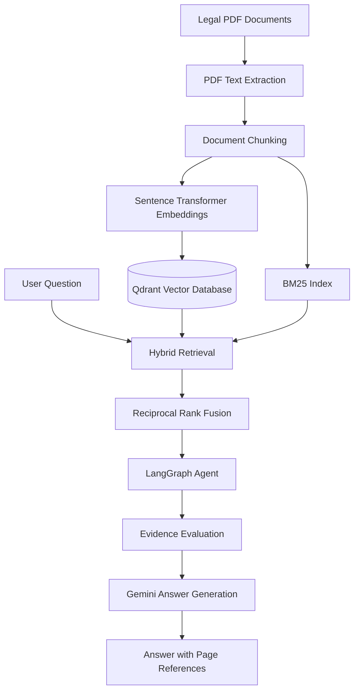

# Legal Evidence Intelligence Agent

An AI-powered legal document analysis agent that retrieves evidence from PDF documents and generates context-grounded answers with page-level citations.

Built using **Python, LangGraph, Gemini, Qdrant, and Sentence Transformers**.

## Overview

Legal documents often contain large amounts of information spread across multiple pages and files. Finding relevant clauses, extracting facts, and verifying answers manually can be time-consuming.

The Legal Evidence Intelligence Agent aims to simplify this process by combining hybrid information retrieval with LLM-powered reasoning.

Users can index legal PDF documents, ask natural-language questions, and receive answers grounded in the retrieved document evidence.

## Key Features

- **PDF Processing:** Extracts text from legal PDF documents using PyMuPDF.
- **Document Chunking:** Splits extracted text into manageable chunks while preserving page references.
- **Semantic Embeddings:** Generates vector embeddings using Sentence Transformers (`all-MiniLM-L6-v2`).
- **Vector Search:** Stores and retrieves document embeddings using Qdrant.
- **Hybrid Retrieval:** Combines BM25 keyword search and semantic search.
- **Reciprocal Rank Fusion:** Combines rankings from both retrieval methods.
- **AI-Powered Answers:** Uses Google Gemini to generate answers based on retrieved evidence.
- **Agent Orchestration:** Uses LangGraph to organize retrieval, evidence evaluation, and response generation.
- **Page-Level References:** Includes source page citations in generated answers.
- **Evidence-Aware Responses:** Designed to acknowledge insufficient evidence rather than inventing unsupported facts.

## Architecture



## Technology Stack

| Component | Technology |
|---|---|
| Programming Language | Python |
| Agent Framework | LangGraph |
| LLM | Google Gemini |
| Embedding Model | all-MiniLM-L6-v2 |
| Vector Database | Qdrant |
| Keyword Retrieval | BM25 |
| PDF Processing | PyMuPDF |
| Retrieval Strategy | Hybrid Search + RRF |

## Project Structure

```text
legal-evidence-agent/
│
├── backend/
│   ├── agent/
│   │   ├── __init__.py
│   │   ├── state.py
│   │   ├── nodes.py
│   │   └── graph.py
│   │
│   ├── __init__.py
│   ├── pdf_loader.py
│   ├── chunker.py
│   ├── embedder.py
│   ├── vector_store.py
│   ├── hybrid_retriever.py
│   ├── answer_generator.py
│   └── index_documents.py
│
├── data/
│   └── documents/
│       └── sample_contract.pdf
│
├── tests/
│
├── .env.example
├── .gitignore
├── requirements.txt
└── README.md
```

## Getting Started

### 1. Clone the repository

```bash
git clone YOUR_GITHUB_REPOSITORY_URL
cd legal-evidence-agent
```

### 2. Create a virtual environment

```bash
python -m venv venv
```

Activate it on Windows:

```powershell
venv\Scripts\Activate.ps1
```

### 3. Install dependencies

```bash
pip install -r requirements.txt
```

### 4. Configure environment variables

Create a `.env` file in the project root:

```env
GEMINI_API_KEY=your_gemini_api_key
```

Get your API key from [Google AI Studio](https://aistudio.google.com/apikey).

### 5. Add documents

Place your legal PDF files inside:

```text
data/documents/
```

A fictional sample contract is included for testing.

### 6. Index documents

Run:

```bash
python -m backend.index_documents
```

This extracts document text, creates chunks, generates embeddings, and stores them in Qdrant.

### 7. Run the agent

Run:

```bash
python -m backend.test_agent
```

The current test script executes a sample question against the indexed contract.

## Example Query

**Question:**

"What is the total contract value?"

**Example response:**

"The total contract value is INR 240,000 (Rupees Two Lakh Forty Thousand Only). [Page 1]"

The response is generated using retrieved document evidence and includes page-level references.

## Engineering Highlights

This project explores several important concepts in modern AI engineering:

- Retrieval-Augmented Generation (RAG)
- Dense vector embeddings
- Sparse keyword retrieval
- Hybrid search and Reciprocal Rank Fusion
- Stateful agent workflows with LangGraph
- Context-grounded LLM generation
- Source attribution and evidence-based answering

## Current Limitations

This is an experimental prototype and not a production-ready legal research system.

- Citation generation is currently handled by the LLM and is not independently validated.
- Evidence sufficiency evaluation is basic and requires stronger relevance checks.
- Contradiction detection and multi-document evidence comparison require further development.
- The current test workflow is designed around a sample document.

## Future Improvements

- Deterministic citation validation.
- Contradiction detection across multiple legal documents.
- Improved evidence relevance evaluation and abstention.
- Multi-document indexing and retrieval.
- FastAPI backend and interactive frontend.
- Retrieval evaluation and answer faithfulness testing.
- LangSmith tracing and observability.

## Disclaimer

This project is intended for educational and experimental purposes only. It does not provide legal advice, and its outputs should not be relied upon for legal decisions.

---

**Built as a practical exploration of AI agents, hybrid retrieval, and evidence-grounded document intelligence.**